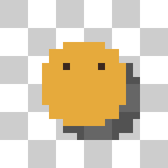

# Aseprite Better

A small collection of quality-of-life commands for [Aseprite](https://www.aseprite.org/),
bundled in one extension.

## Commands

### 1. Toggle Visibility of Bottom Layer

Toggles the bottom-most layer (Layer 1) — the layer at the bottom of the Layers
panel — regardless of which layer is currently selected. Useful for flipping
backgrounds or reference layers on and off while drawing.

Aseprite's built-in `LayerVisibility` command only affects the *active* layer;
this one always targets the bottom of the stack.

### 2. Drop Shadow

Generates a drop shadow from the active layer's artwork. Pixel edges stay crisp —
no anti-aliasing is introduced.

| Mode | What it produces |
|---|---|
| **Darken artwork** | Shadow color = each pixel's own color scaled by "Keep brightness %". Organic, palette-consistent shadows. |
| **Custom color** | One flat color for the whole shadow. Default: **black at 60% opacity** — the classic look. |
| **Snap to palette** | Like custom color, but snapped to the nearest entry of the sprite palette. |

Options: offset X/Y (negatives allowed), softness (alpha box-blur radius; 0 = hard
pixel-art edges), opacity, output (new layer below / merged into current layer),
scope (current frame / all frames of the layer).

### 3. Flatten Colors

`Edit → FX → Flatten Colors` (`编辑 → FX → 扁平化`).

Removes the two things that make pixel art look "muddy":

- **Semi-transparent pixels** (0 < alpha < 100%) become **fully transparent**.
- **Similar colors** are merged into one, so the artwork ends up with few flat
  colors and no visible gradients. The tolerance controls how far apart two
  colors may be and still count as "the same".

The color histogram is collected across all processed frames before clustering, so
the same input color always maps to the same output color in every frame — the
flattening stays consistent over an animation.

A summary is shown afterwards, e.g. `Flattened: 118 colors → 24, cleared 312
semi-transparent pixel(s)`.

**Black threshold** is a separate tolerance measured from pure black: any color
whose **every channel** is at or below the value is snapped to `#000000` before
the normal merge runs. That is how dark noise, off-black outlines and near-black
shadows collapse into one true black instead of a cluster of slightly different
dark greys. `0` disables it. It is per channel, so `16` catches everything up to
`(16,16,16)` — easier to reason about than a Euclidean radius for this case. The
regular merge tolerance still uses Euclidean RGB distance.

Not supported in Indexed color mode (convert with `Sprite → Color Mode → RGB`
first).

### 4. Perfect Pixel (Grid Restore)

`Edit → FX → Perfect Pixel` (`编辑 → FX → 完美像素`).

For artwork that came out of an upscaler or an image generator: it detects the
underlying pixel grid and resamples exactly one colour per cell, turning soft or
noisy "fake pixel art" edges back into crisp pixel blocks.

| Option | Meaning |
|---|---|
| Sampling | **Majority cluster** (two-means per cell — most robust), **Center sample**, or **Median** |
| Grid size | **Auto detect**, or type the column/row count yourself |
| Merge similar colors | Tolerance for merging near-duplicate colours *after* sampling; `0` disables it |
| Output | **New sprite** at the true pixel size, or **new layer** that keeps the canvas size |

Algorithm reference: [Perfect Pixel](https://github.com/theamusing/perfectPixel)
by theAmusing (MIT) — see [THIRD-PARTY-NOTICES.md](THIRD-PARTY-NOTICES.md) for the
full attribution and license text. Grid size is estimated from gradient profiles,
each grid line is then snapped to the strongest nearby edge, and one sample is
taken per cell. This is an
independent Lua implementation for Aseprite, with three deliberate differences:

- Only the gradient estimator is ported; the upstream FFT estimator is not.
- The peak threshold uses a high percentile of the profile instead of its maximum,
  so a transparent margin (whose hard "empty → artwork" edge can dwarf every real
  grid line) does not hide the grid. Upstream would fail on such sprites.
- Sampling is alpha-aware and skips fully transparent pixels, so sprites with
  transparent backgrounds restore cleanly instead of picking up muddy edges.
  A cell with no opaque pixel is written out as fully transparent.

Each cell is sampled independently, so cells sharing one true colour still differ
by a few units — that is why the merge step exists (upstream expects a separate
quantisation pass; here `Flatten Colors` can do it too).

### 5. Redraw Contour

`Edit → FX → Redraw Contour` (`编辑 → FX → 重绘轮廓`).

Detects **thin dark contour lines** — pure black, grey-black, blue-black, anything
whose luminance is under the threshold — and redraws them all as one colour at
exactly one width. Thick dark shapes are recognised as fill and left untouched.

| Option | Meaning |
|---|---|
| Dark threshold | Luminance at or below this counts as dark (0–255). `60` covers grey-blacks and blue-blacks |
| Max contour width | Dark regions whose stroke width is at most this (1–32, default 5) are contours and get redrawn. Anything thicker is treated as a filled dark shape and skipped completely |
| Contour width | Target thickness in px (1–8, default 2) |
| Contour colour | One flat colour for every redrawn contour |

How it works: the dark mask's connected regions are measured with a distance
transform (stroke width = `2 × deepest interior distance − 1`), so a 1-px line
reads as 1, a 4-px line as 4. Regions within `max contour width` are thinned to a
1-px centreline, grown back to the target width and painted. Pixels of the old
line that fall outside the new one are filled with the neighbouring artwork
colour, or dropped to transparency, whichever is nearer.

That width test is what keeps large dark blocks safe: a black silhouette, dark
clothing or a heavy shadow is far thicker than the contour limit, so it is not
touched at all — only genuinely line-like dark strokes are rewritten.

Notes:

- A contour that touches a thick dark shape becomes one connected region and is
  therefore judged by the thicker part, so it is skipped. Raise *Max contour
  width* if the shape and its outline are fused and you want them redrawn.
- Detection is by colour: small dark details under the threshold (pupils, dots)
  are treated as contours as well.

### 6. Denoise

`Edit → FX → Denoise` (`编辑 → FX → 去噪点`).

Replaces isolated speckle pixels with the colour around them. Unlike *Flatten
Colors*, which quantises the whole image, this only touches pixels that do not
belong to their neighbourhood.

| Option | Meaning |
|---|---|
| Mode | **Single pixel** — only a lone pixel whose entire 8-neighbourhood is one colour (and it differs from it) is replaced. **Two pixels** — additionally joins 1×2 / 2×1 specks whose combined surroundings are unanimous |
| Colour similarity threshold | How far apart two colours may be and still count as the same (RGB distance, default 24) |

Colour comparisons are **RGBA**: alpha is part of the colour, and fully
transparent counts as a colour of its own. So a semi-transparent speck inside
opaque artwork is noise (different alpha even with identical RGB), and a lone
pixel floating in the transparent background is noise too — its neighbours all
agree on "transparent", so it is erased. Ordinary silhouette edges stay safe
because their neighbourhood mixes artwork and transparency and therefore never
reaches unanimity.

**Semi-transparent pixels (0 < alpha < 100%) are always treated as speckle.**
With a unanimous neighbourhood they take the surrounding colour. On a mixed
neighbourhood — the classic case being anti-aliasing residue on the artwork
edge, half outline black and half pure transparent — they resolve to the
dominant side: transparent when transparent neighbours are at least as many as
opaque ones (ties included), otherwise the most common opaque neighbour colour.
Fully opaque pixels on mixed boundaries are artwork and stay untouched.

Consequence: intentional semi-transparent art (soft shadows, alpha gradients)
gets normalised — outer semi pixels are resolved inward/outward and the region
slowly becomes hard-edged. This command assumes pixel art with hard alpha.

How the decision works: a pixel is noise when **every** neighbour agrees with
one representative colour (within the threshold) *and* the pixel itself does not
match that colour. Requiring unanimity is what separates real specks from
structure:

- a 2-px speck has a dissenting neighbour, so *Single pixel* leaves it alone
  (switch to *Two pixels* to clean it);
- a pixel on the boundary between two colours never has unanimous surroundings,
  so edges are safe;
- a 3-px or larger blob is never "isolated" and is never touched;
- a pixel whose colour is already within the threshold (alpha included) is
  left as it is.

Pixels with fewer than 5 in-bounds neighbours (canvas corners) are skipped —
too little context to judge safely. Floating specks and 1-2 px floating pairs
are erased to fully transparent.

## License

CC0 — Public Domain.
